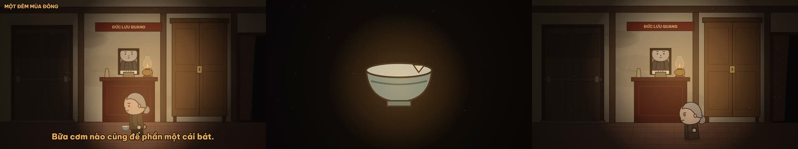
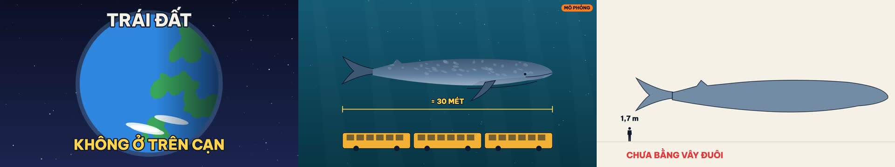

# contentByAi

Xưởng sản xuất video YouTube hoạt hình, toàn bộ hình vẽ bằng code (canvas + rough.js, không dùng ảnh AI). Gồm: engine vẽ, bộ cảnh từng kênh, kịch bản các tập, pipeline giọng đọc → render → mô tả/thumbnail, web quản lý Studio, và bộ skill cho Claude Code viết kịch bản và dựng video.

| Kênh | id | Nội dung |
|---|---|---|
| Vẽ Là Hiểu | `ve-la-hieu` | Truyền thuyết và sử Việt, kể tếu táo |
| Long Story Drawn | `the-human-manual` | Người cổ đại (tiếng Anh) |
| Nói Có Sách | `noi-co-sach` | Shorts tranh luận câu nói xưa về gia đình |
| Nhân Gian Chưa Kể | `neu-ban-la` | Truyện tâm linh dân gian kể ngôi "tôi", tông tối |
| Hạt Bụi Xanh | `hat-bui-xanh` | Khoa học kiểu phim tài liệu: vũ trụ, sinh vật khổng lồ |

## Cấu trúc

| Đường dẫn | Nội dung |
|---|---|
| `engine/` | Engine vẽ: API `k` (nét tay, chữ, thời gian/cue, camera), nhân vật, đạo cụ, icon, nét cọ, 3D, player, font |
| `channel/` | Bộ cảnh và bảng màu từng kênh (`nhan-gian*.js`, `hat-bui-xanh*.js`, `ve-la-hieu.js`…), ảnh kênh (`art-*.js`), hồ sơ kênh, nghiên cứu ngách (`research/`) |
| `videos/<slug>/` | Mỗi tập: `video.js` (lời đọc + hình từng cảnh), `thumbs.js` (3 mẫu thumbnail), `kich-ban.md` (kịch bản, sổ dữ kiện), `assets/` (ảnh thật + `credits.json`) |
| `scripts/` | `build.mjs` (giọng → render → mp4, phụ đề, mô tả), `tts.mjs` (gọi API giọng đọc), `thumbs.mjs`, `anh-that.mjs` (ảnh/clip NASA, ESA…), `youtube.mjs` / `upload.mjs` / `analytics.mjs`, `soat-kich-ban.mjs`, `next-slot.mjs`, `niche/` (tìm ngách) |
| `studio/` | Web Studio (cổng 5180): kênh, chủ đề, lịch đăng, hàng chờ build/upload, số liệu YouTube, "Gói đăng" |
| `data/studio.json` | Dữ liệu Studio: kênh, chủ đề, trạng thái, lịch |
| `.claude/skills/` | Skill cho Claude Code: `lam-video`, `y-tuong-video`, `tim-ngach`, `thumbnail`, `concept-truyen-thong`, `phan-tich`, và skill "vibe" từng kênh `kenh-*` |
| `CLAUDE.md` | Hướng dẫn API vẽ và quy ước dự án cho Claude |

Không có trong repo (xem `.gitignore`): video đã render (`output/`), khung hình tách từ clip (`videos/*/assets/clips/`, tạo lại bằng `scripts/anh-that.mjs --video`), `.env` và token YouTube (`.secrets/`), file ghi âm mẫu giọng.

## Cài đặt

```bash
npm install
npx playwright install chromium      # trình duyệt để render
npm run setup                        # Python venv + edge-tts (giọng miễn phí)
cp .env.example .env                 # điền khoá: OMNI_URL/OMNI_KEY (OmniVoice), ELEVENLABS_*, YOUTUBE_API_KEY…
```

Cần thêm `ffmpeg`. Đăng YouTube qua Studio cần `.secrets/client_secret.json` (OAuth client của Google Cloud); token từng kênh tự lưu ở `.secrets/tokens/`.

## Lệnh hay dùng

```bash
node scripts/build.mjs <slug>              # đọc giọng + render → output/<slug>/video.mp4, thumbnail, phụ đề, mô tả
node scripts/build.mjs <slug> --stills     # ảnh tĩnh từng cảnh để soát
node scripts/build.mjs <slug> --meta       # chỉ làm lại mô tả + thumbnail
node scripts/thumbs.mjs <slug>             # 3 mẫu thumbnail
node scripts/tts.mjs "câu" out.mp3 --provider omnivoice --voice default
npm run studio                             # web Studio ở http://localhost:5180
```

Ví dụ chạy ngay: `node scripts/build.mjs mau-nhan-gian` hoặc `node scripts/build.mjs mau-hat-bui-xanh` (giọng Edge miễn phí).

## Mẫu

**Nhân Gian Chưa Kể** (`videos/mau-nhan-gian/video.js`)



**Hạt Bụi Xanh** (`videos/mau-hat-bui-xanh/video.js`)



## Viết một cảnh

```js
import { shade, quote } from '/channel/nhan-gian.js';
import { BA, ch, nha } from '/channel/nhan-gian-ke.js';

export default {
  meta: { title: 'Thử', tts: 'edge', voice: 'vi-VN-NamMinhNeural', minDuration: 0 },
  scenes: [{
    say: '{a}Các cụ bảo, Ông Kẹ gõ cửa đúng ba tiếng.',
    draw(k) {
      nha(k, { time: 'night' });
      ch(k, 960, 990, 330, { ...BA, view: 'side', face: 'calm' });
      shade(k, 0.75, [{ x: 960, y: 600, r: 600, warm: 1, flicker: 1 }]);
      quote(k, 'Ông Kẹ gõ cửa đúng ba tiếng.', 'a', { size: 56 });
    },
  }],
};
```

`{a}`, `{b}`… trong lời đọc là mốc thời gian lấy từ giọng đọc thật; trong hình dùng `k.at('a', 0.8)` (0→1) hoặc `k.cue('a')`. API đầy đủ: `CLAUDE.md`.

## Tạo giọng đọc

| `--provider` | Cần gì | Ghi chú |
|---|---|---|
| `omnivoice` | `OMNI_URL` (+ `OMNI_KEY`) trỏ tới server OmniVoice | Giọng `default` của Nhân Gian Chưa Kể và Hạt Bụi Xanh; số được đổi thành chữ trước khi gửi (`vi-so.mjs`) |
| `elevenlabs` | `ELEVENLABS_API_KEY`, `ELEVENLABS_VOICE_ID` | Model mặc định `eleven_flash_v2_5` |
| `edge` | Python + `edge-tts` | Miễn phí |

Trả về mp3 + `.json` mốc từng từ `[{ t, d, text }]`.
